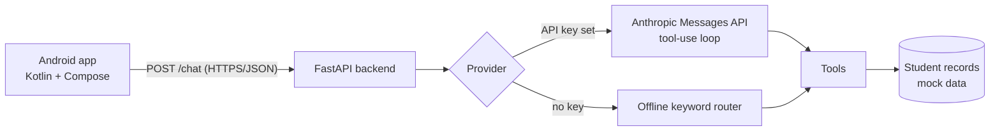

# AI Academic Assistant

A mobile chatbot that helps university students with everyday administrative questions. A student asks in plain English or Spanish ("¿Cuál es mi horario?", "How many social service hours do I have left?") and the assistant looks the answer up in the student's records and replies. It can also submit requests such as an enrollment certificate.

It is a rebuild of a university project, designed as a small but complete system: an **Android app** (Kotlin, Jetpack Compose) talking to a **cloud backend** (Python, FastAPI) that lets a **large language model call tools** over student data.

> All student data in this repository is synthetic. No real records are used.

## What it can do

| Ask about | Tool the model calls |
| --- | --- |
| Current schedule with days, times, buildings and classrooms | `get_schedule` |
| Partial grades and running averages this semester | `get_current_grades` |
| Final grades of previous semesters (all, or one semester) | `get_grade_history` |
| Social service hours completed and remaining | `get_social_service_status` |
| Optative (elective) credits, enrolled and available courses | `get_optative_curriculum` |
| Fees, payment status, and total pending | `get_tuition_billing` |
| Submit a request (certificate, grade report, letter, receipt) | `submit_service_request` |

## Architecture



1. The app sends `{session_id, message}` to `POST /chat`.
2. The backend keeps a short per-session history and asks the model for a reply, giving it the tool definitions.
3. When the model asks for a tool, the backend runs it and returns the result to the model. This repeats until the model writes a final answer (limited to 5 rounds).
4. The app shows the reply, plus which tools were used.

### Design decisions

- **The model never chooses which student it reads.** The student id comes from the authenticated request and is injected by `tools.dispatch`. It is not a tool argument, so a prompt injection cannot ask for another student's records. (There is a test for this.)
- **Tools never raise.** Bad arguments, unknown tools and missing data come back as `{"error": ...}` and are flagged to the model with `is_error`, so it can explain the problem instead of the request crashing.
- **Works without an API key.** `OfflineProvider` routes keywords to the same tools. That makes the demo, the tests and CI free and deterministic, and shows the tool layer is independent of the model.
- **Bounded loop and history.** At most 5 tool rounds per message, and session history is trimmed in whole user/assistant pairs.
- **Testable client.** The Android `ChatViewModel` depends on a `ChatRepository` interface, so it is unit-tested with a fake repository.

## Run the backend

Requires Python 3.11+.

```bash
cd backend
python -m venv .venv && source .venv/bin/activate   # Windows: .venv\Scripts\activate
pip install -r requirements-dev.txt

# Optional: use a real LLM. Without a key the offline demo provider is used.
export ANTHROPIC_API_KEY=your-key                   # Windows (PowerShell): $env:ANTHROPIC_API_KEY="your-key"

uvicorn app.main:app --reload --host 0.0.0.0 --port 8000
```

Try it:

```bash
curl -s localhost:8000/chat -H "Content-Type: application/json" \
  -d '{"session_id":"demo","message":"What is my schedule?"}'
```

Interactive docs are at <http://localhost:8000/docs>. With Docker: `docker build -t academic-assistant backend && docker run -p 8000:8000 -e ANTHROPIC_API_KEY academic-assistant`.

Run the tests:

```bash
cd backend && pytest -q
```

## Run the Android app

Requires Android Studio (Ladybug or newer) with JDK 17.

1. Start the backend as above.
2. Open the `android/` folder in Android Studio and let Gradle sync.
3. Run on an emulator. It reaches your computer at `http://10.0.2.2:8000/`.
4. On a physical phone on the same Wi-Fi, pass your computer's LAN address:
   `./gradlew installDebug -PapiBaseUrl=http://192.168.1.50:8000/`

Plain HTTP is allowed in debug builds only. A release build needs an HTTPS endpoint.

Unit tests: `cd android && ./gradlew testDebugUnitTest`

## Project layout

```
backend/
  app/main.py     FastAPI routes, sessions, demo auth
  app/llm.py      Anthropic tool-use loop and offline provider
  app/tools.py    Tool schemas and implementations
  app/data.py     Synthetic student records
  tests/          Tool, API and tool-loop tests (no network needed)
android/
  app/src/main/java/com/hugalde/academicassistant/
    data/         Retrofit API, models, repository
    ui/           ChatViewModel and Compose screen
```

## Roadmap

- Real authentication (JWT from the university's identity provider) instead of the demo header
- Persistent sessions (Redis or Postgres) and rate limiting
- Streaming replies
- Retrieval over school regulations and FAQs for policy questions
- iOS client in Swift sharing the same API
- Offline-first caching on the device

## License

MIT
